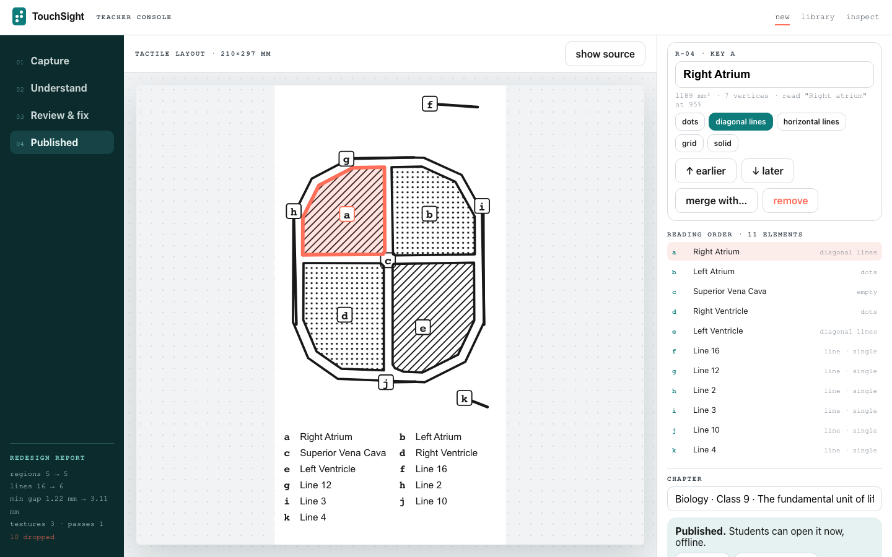
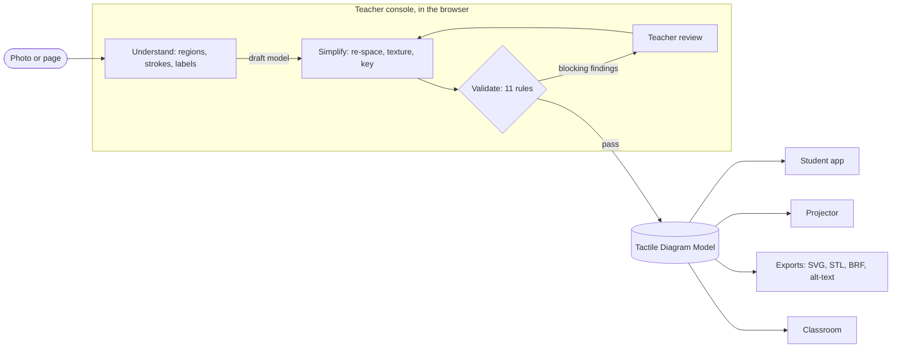
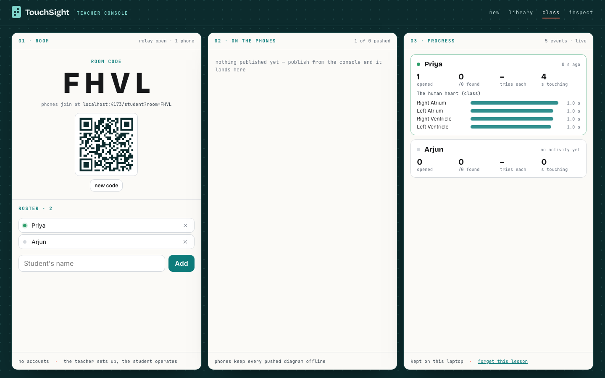
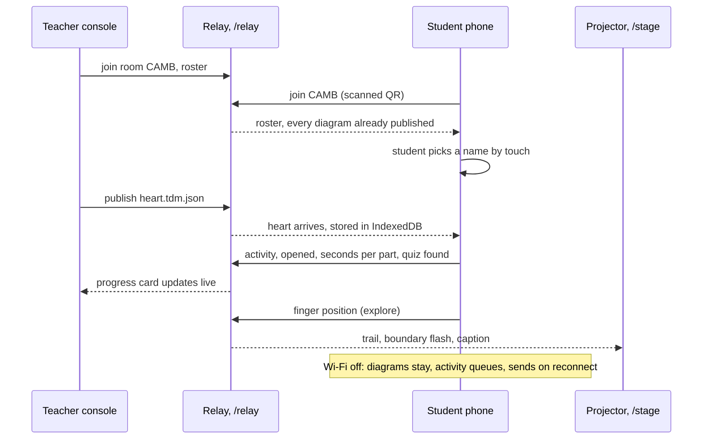

<h1 align="center">TouchSight</h1>

<h3 align="center">A textbook can have a braille edition. A blackboard can't.</h3>

<p align="center">
  TouchSight is an <b>accessibility compiler for diagrams</b>. It reads the structure of a diagram a teacher photographs,<br>
  redesigns that structure for a fingertip, and refuses to publish anything a finger could not read.<br>
  The one verified model is touched on a phone, mirrored on a projector, printed as a relief and a braille key,<br>
  and pushed to every phone in the room.
</p>

<p align="center">
      
</p>
<p align="center">
      
</p>

<p align="center">
  <a href="#why-a-fingertip-needs-a-compiler">Why a compiler</a> · <a href="#how-a-diagram-compiles">How it compiles</a> · <a href="#where-the-model-goes">Where the model goes</a> · <a href="#the-validator">The validator</a> · <a href="#a-classroom-live">Classroom</a> · <a href="#driven-without-sight">Without sight</a> · <a href="#measured">Measured</a> · <a href="#what-it-cannot-do-yet">Limits</a> · <a href="#run-it">Run it</a> · <a href="#repository">Repository</a>
</p>

---



<p align="center">
  Image describers tell a blind student <i>about</i> a picture. Braille translators convert text. Tactile-graphics software starts<br>
  from a transcriber's hand drawing and ends at an embosser that costs lakhs, weeks after the lesson. TouchSight is the compiler<br>
  between the photograph and all of them: in the browser, no server, no account, no network once installed,<br>
  photo to verified tactile model inside one class period.
</p>

## Why a fingertip needs a compiler

A diagram made for eyes cannot be scaled, filtered or described into one made for fingers. The physics of touch forbids it.

| Physical fact | What it forces |
|---|---|
| A fingertip resolves about 1–2 mm; raised lines closer than 3 mm merge into one ridge | Geometry is **re-spaced**, not scaled |
| Touch reads serially, one region at a time; vision reads in parallel | Detail is **cut** to what survives serial reading |
| Colour, shading, gradients and hairlines carry no tactile information | Meaning **moves** into texture, outline and a braille key |
| A braille cell is 6 mm wide and does not shrink | The key is laid out at print size, and must **fit the sheet** |

So the middle stage is a constraint solver over real geometry in millimetres on an A4 sheet, and a deterministic validator sits between it and publish.

## How a diagram compiles



| Stage | What happens | Where |
|---|---|---|
| **Understand** | Adaptive threshold and contour tracing find enclosed regions; straight strokes are found with a probabilistic Hough transform on the ink mask; OCR reads printed labels; each label is tied to a region or line through its leader line. Results are drawn over the photo as they arrive. | `app/src/pipeline/` |
| **Simplify** | Regions are offset apart until every gap is at least 3 mm, neighbours get different textures, lines under 1.2 mm are widened, anything below 60 mm² or 8 mm is dropped, and the braille key is laid out at 10 mm pitch so it fits the margin. | `app/src/tdm/simplify.ts` |
| **Validate** | Every rule in [the validator](#the-validator) runs against the sheet. A finding names the rule, the elements and the spot in millimetres. | `app/src/tdm/validate.ts` |
| **Review** | The teacher confirms or removes every detected relation (rule R3 blocks until they do), renames, merges, re-orders, and writes or confirms the one line the phone speaks after a part's name. A glossary pre-fills about seventy common parts in English, Hindi and Punjabi. | `app/src/routes/teacher/Workbench.tsx` |
| **Publish** | The model is saved to the library on the laptop, pushed to every phone in the room, and exported four ways. | `app/src/export/`, `app/src/class/` |

Nothing downstream ever reads the source image again. Every surface renders from the model.

## Where the model goes

<table>
<tr>
<td width="34%" valign="top">

**Student app** · Android phone, installed from the browser, Wi-Fi off

A finger on the screen feels a tick at every boundary and a different rhythm per texture, hears the part's name when it rests and what the part does a moment later. A tour reads the sheet in order; a quiz asks for a part and the finger is the answer; the key shows real braille from liblouis. A sound layer doubles the haptics on phones without a motor: pitch follows height, timbre follows texture, a click marks each boundary, panned with position. High-contrast mode for low vision. English, Hindi, Punjabi.

</td>
<td width="66%" valign="top">

**Classroom** · console and phones, no accounts

The console shows a four-letter room code and a QR. A phone joins once; from then on every publish lands on it and stays there offline. The teacher types the roster, the student picks their name by touch, and their activity flows back live: diagrams opened, seconds under the finger per part, quiz targets found and tries per target. Activity recorded offline is queued on the phone and sent when the link returns.



</td>
</tr>
</table>

**Projector view** mirrors the student's finger live on the classroom screen through a relay on the app's own origin, with a trail, boundary flashes, captions in the chosen language and a measured round trip, so the sighted class and the teacher see what the student is touching.

**Exports**, all from the same model, all in true millimetres:

| File | What it is | Checked |
|---|---|---|
| `*.tactile.svg` | A4 sheet for swell paper or an embosser: textures, outlines, 1.5 mm braille dots, braille laid out as it prints | page size, dot geometry |
| `*.relief.stl` | 3-D printable relief, textures as raised features, braille as domes; shown in the console in 3-D from the very bytes exported | every shell closed |
| `*.brf` | Braille key for an embosser, UEB grade 1 or Bharati | cell and line counts |
| `*.alt.txt` | Alt-text in reading order, then the relations the figure teaches | word count |
| `*.tdm.json` | The model itself | schema |

## The Tactile Diagram Model

Everything downstream reads one JSON document, in millimetres on an A4 sheet.

```json
{
  "tdm": "0.1", "id": "heart", "title": "The human heart", "sheet": { "w": 210, "h": 297, "margin": 15 },
  "regions": [{ "id": "r-la", "name": { "en": "Left atrium", "hi": "बायाँ आलिंद" }, "polygon": [[106,53],[146,53],[146,95],[106,95]],
                "texture": "dots", "keyRef": "c", "confidence": 0.96, "meaning": "receives oxygenated blood from the lungs" }],
  "lines":   [{ "id": "l-01", "name": { "en": "Aorta" }, "path": [[120,20],[150,40]], "width": 1.2, "style": "single", "arrow": "end", "keyRef": "f" }],
  "relations": [{ "from": "r-la", "to": "r-lv", "kind": "flows-into", "direction": "forward", "source": "teacher" }],
  "key": [{ "ref": "c", "regionId": "r-la", "text": { "en": "Left atrium" }, "braille": { "en": "⠠⠇⠑⠋⠞ ⠁⠞⠗⠊⠥⠍" } }],
  "readingOrder": ["r-ra", "r-rv", "r-la", "r-lv", "l-01"],
  "validation": { "status": "pass", "blocking": [], "advisory": [] },
  "provenance": { "pipeline": "0.1", "teacherReviewed": true, "reviewedAt": "2026-10-30T09:12:00+05:30" }
}
```

Full schema: [docs/TDM-SPEC.md](docs/TDM-SPEC.md). Standalone CLIs under [`packages/`](packages/) turn any `.tdm.json` into the four exports without the app.

## The validator

Deterministic, located, named. A model with any blocking finding cannot be published.

| Rule | Checks | Threshold | Blocks |
|---|---|---|---|
| S1 | Separation between raised elements | ≥ 3.0 mm (BANA 2010) | yes |
| S2 | Minimum region area; minimum line length | ≥ 60 mm²; ≥ 8 mm | yes |
| S3 | Minimum raised line width | ≥ 1.2 mm | yes |
| T1 | Neighbouring regions use different textures | within 5 mm | yes |
| K1 | Braille key fits the sheet, laid out exactly as it prints | 10 mm line pitch, 6 mm cells | yes |
| M1 | Everything inside the sheet margins | 15 mm | yes |
| R1 | Relations reference existing elements | — | yes |
| R2 | Every element in the reading order exactly once | — | yes |
| R3 | Every relation the pipeline detected is confirmed or removed by a teacher | — | yes |
| O1 | OCR confidence of every label used | ≥ 0.75 | advisory |
| N1 | Every element has a real name | — | advisory |

A finding reads `S1: Left atrium and Right atrium are 1.8 mm apart (min 3)`, with the ids and the spot on the sheet. Rules, thresholds and sources: [docs/VALIDATOR-RULES.md](docs/VALIDATOR-RULES.md).

## A classroom, live

The relay is under a hundred lines of WebSocket on the same static server that serves the app. It holds rooms in memory and on disk, fans out, and forgets nothing a phone still needs.



Room state survives a console refresh: the relay re-sends the roster and the published diagrams on reconnect, phones keep theirs, progress is kept on the laptop.

## Driven without sight

Every control on the student app speaks on the first touch and acts on the second. A spoken introduction plays on first launch and again from the `?` button. Beyond that, the whole app is operable by gesture and by voice.

| Gesture | Does |
|---|---|
| One finger moves | Feel boundaries and textures; the part's name is spoken when the finger rests, then what it does |
| Two-finger swipe left or right | Explore → Tour → Quiz → Key |
| Two-finger double tap | Says where the finger is on the sheet |
| Two fingers held still | Listens for a spoken command or question |
| Three-finger tap | Next language: English, Hindi, Punjabi |
| `?` | Repeats the introduction and the gesture list |

Spoken commands are matched in English, Hindi, Punjabi and romanised Hindi and Punjabi: *where am I*, *what does it do*, *tour*, *quiz*, *key*, *repeat*, *next*, *previous*, *play*, *pause*, *library*, *help*, a language name. Questions about the diagram are answered from the model itself, never guessed: *what does the left atrium do*, *which part pumps blood to the body*, *how many parts*, *what connects to the left ventricle*, *where is the left ventricle*.


## Measured

From [benchmark/RESULTS.md](benchmark/RESULTS.md): 25 figures (8 development figures plus 17 Wikimedia Commons diagrams across biology, physics, chemistry, geography, mathematics and astronomy), headless Chromium, production build, no network, every figure through understand → redesign → validate → exports with no teacher. Two tables in the file on purpose: a figure can pass every geometric rule and still be semantically wrong.

| What the pipeline read | What it made |
|---|---|
| Labels read: mean **54%** over 25 figures; **10 figures at or above 90%** (digestive, cell cycle, eye, flower, heart line art, neuron, plant cell, respiratory) | Validator geometry clean on the first run: **23/25** (the two misses are K1, a braille key that did not fit) |
| Regions named: mean **20%**; 100% on the clean heart, 0% where labels sit over gradients or where the figure is symbolic | Minimum gap raised to ≥ 3.0 mm on every figure that had one below |
| Symbolic and numeric labels (DNA formula, distillation, three maths figures, pulley): **0%**, see limits | All four exports on **25/25**, every STL shell closed |
| Relations: 91 proposed, **3 of 83** truth pairs matched automatically; rule R3 holds every one for the teacher | Median **1.3 s** from photo to four files |

Teacher-correction counts and the eyes-closed location test are protocols in [benchmark/CORRECTIONS.md](benchmark/CORRECTIONS.md) and [benchmark/USABILITY.md](benchmark/USABILITY.md), with no recorded runs yet.

## What it cannot do yet

- **Naming regions is the weak link** (region recall 20% across 25 figures, 100% on the clean heart). Labels are read well on printed figures; tying a label to the right enclosed area fails over gradients, broken leader lines and white pockets between organs. The teacher renames in the console.
- **Symbolic, numeric and non-English labels are not read.** Formulas, angle marks and numerals scored 0%; a French diagram scored 0%. Clean printed words in English are the target.
- **Relations are proposed from stroke adjacency only.** They are often wrong, which is why rule R3 blocks every one until a teacher confirms it.
- **3-D shaded colour figures** read at 64% and **low-resolution paintings** at 46–58% label recall.
- **Hand-drawn chalk on a blackboard** is not supported. Clean printed, photocopied or projected figures are the target.
- **Haptics are Android-only** (iOS Safari has no Vibration API); audio, sound layer, quiz and print work everywhere. A phone screen is for exploration; the raised print is the study artefact.
- **The projector mirror and the classroom link need the phone and laptop on one link** (a hotspot and tunnel, or the same machine); the student app itself needs no network.
- **Braille tables** (UEB grade 1, Bharati Hindi and Punjabi via liblouis) have not yet been checked by a braille reader.
- **Spoken commands need a network.** Android's speech recognition runs on a server; the gestures do the same jobs offline.

Full list: [benchmark/LIMITS.md](benchmark/LIMITS.md).

## Run it

```bash
cd app && npm install
npm run build
node scripts/serve.mjs 4173        # app on http://localhost:4173, relay at /relay
```

| Open | On |
|---|---|
| `/teacher` | the laptop: capture, understand, review, publish, export |
| `/teacher/class` | the laptop: room code, QR, roster, progress |
| `/student` | an Android phone: add to home screen, then Wi-Fi off |
| `/student?room=CODE` | what the QR encodes; the phone joins the room |
| `/stage` | the projector |

A phone on another network needs https for installation, vibration and the microphone: `cloudflared tunnel --url http://localhost:4173`, then paste the address into the Class view so the QR carries it.

```bash
npm run dev                    # development server
npm test                       # 34 unit tests: model, solver, validator, explorer, gestures, answers, glossary, exports
npm run benchmark              # rewrites benchmark/RESULTS.md from a full headless run; a partial run never overwrites it
node scripts/shoot-teacher.mjs # headless walkthroughs of each surface against a running build:
node scripts/shoot-student.mjs #   shoot-home, shoot-teacher, shoot-student, shoot-stage, shoot-class
```

The export CLIs run from the repository root without the app:

```bash
npm install
npm run export:svg examples/bio-heart-01.tdm.json
npm run export:stl examples/bio-heart-01.tdm.json
npm run export:braille examples/bio-heart-01.tdm.json
npm run export:alt-text examples/bio-heart-01.tdm.json
npm run test:exports           # 6 tests
```

## Repository

```
touchsight/
├── app/                         the web app (React 19, Vite, TypeScript, PWA)
│   ├── public/
│   │   ├── liblouis/            liblouis asm.js build + UEB and Bharati tables, run in a Web Worker
│   │   ├── tesseract/ tessdata/ Tesseract.js worker and English traineddata, served locally
│   │   ├── vendor/opencv.js     OpenCV.js
│   │   └── fonts/ icons/        self-hosted type and PWA icons
│   ├── scripts/
│   │   ├── serve.mjs            static server + WebSocket relay (stage mirror, classroom rooms)
│   │   ├── run-pipeline.mjs     the benchmark runner: every raw figure → RESULTS.md
│   │   ├── score.mjs            semantic scoring against truth files
│   │   └── shoot-*.mjs          headless Playwright walkthroughs of landing, teacher, student, stage, class
│   └── src/
│       ├── pipeline/            understand: cv, segment, lines, ocr, associate, overlay
│       ├── tdm/                 the model: types, geometry, simplify (solver), validate, edit, io
│       ├── export/              svg, stl (+ shell check), brf, braille, alt-text
│       ├── student/             explorer, hit-testing, gestures and touch-to-hear, question answering, braille, mirror
│       ├── device/              haptics, sound layer, speech synthesis, speech recognition
│       ├── class/               classroom client: rooms, roster, publish, activity, offline queue
│       ├── i18n/                strings and the part glossary in English, Hindi, Punjabi
│       ├── store/               IndexedDB library and progress
│       ├── components/          sheet canvas, braille cells, 3-D relief viewer, export panel
│       └── routes/              landing, teacher (workbench, library, inspector, class), student (library, explore, key), stage, device check
├── packages/                    standalone Node CLIs: export-svg, export-stl, braille, alt-text, tdm-runtime
├── docs/                        TDM-SPEC.md, VALIDATOR-RULES.md
├── benchmark/
│   ├── raw/                     25 figures + SOURCES.md (licences)
│   ├── truth/                   one truth file per figure: regions, lines, labels, relations
│   ├── results/                 RESULTS.md inputs: overlays, draft models, exports, screens
│   ├── accessibility/           described catalogue of every figure
│   ├── RESULTS.md · LIMITS.md · CORRECTIONS.md · USABILITY.md
│   └── scripts/                 drawn schematic figures
└── examples/                    a hand-authored heart model
```

## Built on

| | Used for | Licence |
|---|---|---|
| [OpenCV.js](https://github.com/TechStark/opencv-js) | regions, contours, skeletons in the browser | Apache-2.0 |
| [Tesseract.js](https://github.com/naptha/tesseract.js) | printed-label OCR in the browser | Apache-2.0 |
| [liblouis](https://liblouis.io) | braille translation, UEB and Bharati tables | LGPL-2.1 |
| [three.js](https://threejs.org) | STL export and the 3-D relief viewer | MIT |
| [clipper-lib](https://sourceforge.net/projects/jsclipper/) · [earcut](https://github.com/mapbox/earcut) | polygon offsetting for the solver; triangulation for the relief | BSL-1.0 · ISC |
| [idb](https://github.com/jakearchibald/idb) · [ws](https://github.com/websockets/ws) · [qrcode](https://github.com/soldair/node-qrcode) | library on the phone; relay; room QR | ISC · MIT · MIT |
| Web Speech, Web Audio, Vibration, Pointer Events | voice, sound layer, haptics, multi-finger gestures | browser APIs |

Tactile thresholds follow the BANA *Guidelines and Standards for Tactile Graphics* (2010). Figure sources and licences: [benchmark/raw/SOURCES.md](benchmark/raw/SOURCES.md).
