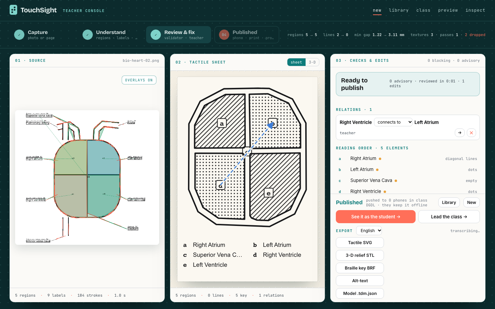
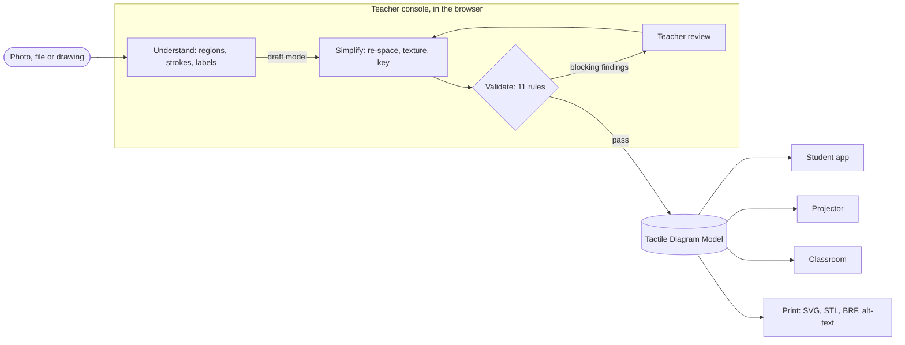
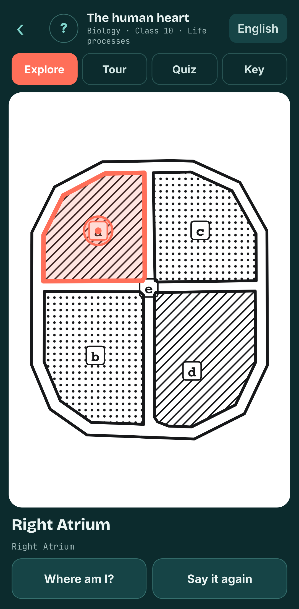
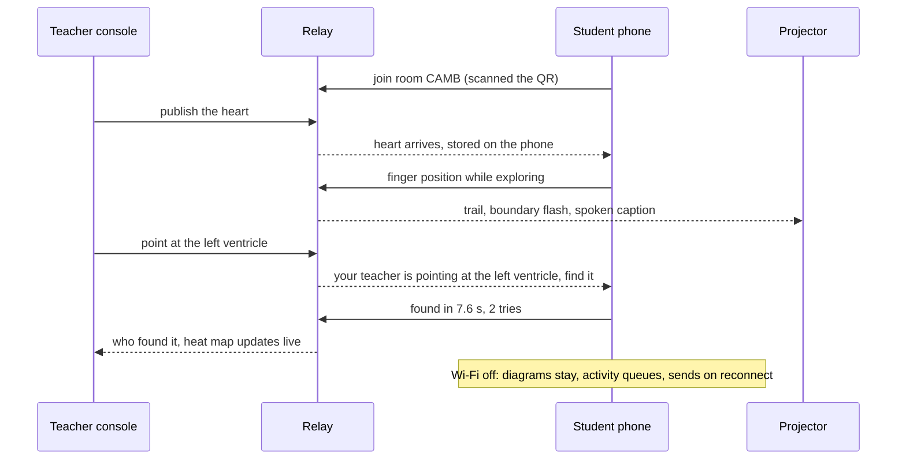
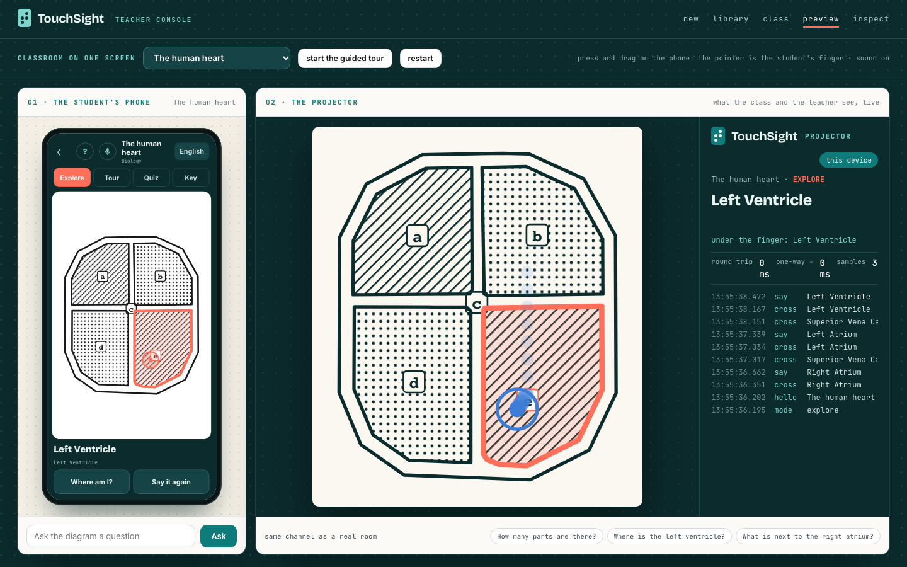

<h1 align="center">TouchSight</h1>

<h3 align="center">A textbook can have a braille edition. A blackboard can't.</h3>

> **An accessibility compiler for diagrams.** A teacher photographs, uploads or draws a diagram; seconds later a blind student is exploring it on an ordinary phone by touch, sound and voice, the class follows on the projector, and the same model prints as a raised sheet with a braille key.

<p align="center">
          
</p>

<p align="center">
  <b><a href="https://touchsight-one.vercel.app">Live demo</a></b> · <a href="#the-gap">The gap</a> · <a href="#how-a-diagram-compiles">How it compiles</a> · <a href="#five-surfaces-one-model">Five surfaces</a> · <a href="#a-classroom-live">Classroom</a> · <a href="#driven-without-sight">Without sight</a> · <a href="#the-validator">The validator</a> · <a href="#measured">Measured</a> · <a href="#run-it">Run it</a> · <a href="#project-structure">Project structure</a> · <a href="#what-comes-next">What comes next</a>
</p>



## The gap

Software for tactile diagrams is rare, and the need for it is proven. The closest work is at IIT Delhi: the [Raised Lines Foundation](https://thelogicalindian.com/exclusive/raised-lines-foundation-iit-delhi/), which grew out of the institute's Centre of Excellence in Tactile Graphics, designs tactile diagrams by hand and prints them as tactile books for NCERT maths and science ([YourStory, 2019](https://yourstory.com/2019/01/iit-delhi-braille-tactile-diagram-rlf)). That work settles whether blind students learn from diagrams they can touch. It also shows where hand production stops: a fixed, published list of textbook figures, made centrally, reaching a school as a book.

**TouchSight starts where that list ends,** with the diagram this teacher has today: on a worksheet, in a different textbook, projected in class, or drawn on the console's own board.

| | Tactile books made by hand | Image describers | TouchSight |
|---|---|---|---|
| **Which diagrams** | A fixed list of textbook figures | Any picture | Any diagram the teacher photographs, uploads or draws |
| **When it arrives** | With the printed book | At once, as a paragraph | Inside the class period; the median compile is 1.5 s |
| **What the student gets** | Raised paper | Words about the picture | The shape itself under a finger, with speech, a tour and a quiz; the same model prints as a relief |
| **What guards quality** | A trained designer | Nothing | Eleven validator rules and the teacher's confirmation |

We have not found another tool that takes a teacher's own diagram to a blind student's hands on the day it is taught. The compiler, the validator and the delivery to a whole classroom in one tool is what is new here, and it is the piece a school for the blind, an inclusive classroom, a braille press or a textbook board would use.

## Why a fingertip needs a compiler

A diagram made for eyes cannot be scaled, filtered or described into one made for fingers. The physics of touch forbids it.

| Physical fact | What it forces |
|---|---|
| A fingertip resolves about 1–2 mm; raised lines closer than 3 mm merge into one ridge | Geometry is **re-spaced**, not scaled |
| Touch reads one region at a time; vision reads everything at once | Detail is **cut** to what survives serial reading |
| Colour, shading and hairlines carry no tactile information | Meaning **moves** into texture, outline and a braille key |
| A braille cell is 6 mm wide and does not shrink | The key is laid out at print size and must **fit the sheet** |

So the middle of TouchSight is a constraint solver over real geometry in millimetres on an A4 sheet, with a deterministic validator between it and publish.

## How a diagram compiles



| Stage | What happens |
|---|---|
| **Understand** | Contour tracing finds the enclosed parts, a Hough transform finds the strokes, and OCR reads the printed labels in four passes. Each label is tied to one part through containment, its leader line or the nearest edge. |
| **Simplify** | Parts are pushed apart until every gap is at least 3 mm, neighbours get different textures, thin lines are widened, anything too small to feel is dropped, and the braille key is laid out to fit the margin. |
| **Validate** | [Eleven rules](#the-validator) run against the sheet. A finding names the rule, the elements and the spot in millimetres. |
| **Review** | The teacher confirms or removes every detected relation, renames what was misread, and confirms the one line the phone speaks after each part's name. A glossary pre-fills about seventy common parts in English, Hindi and Punjabi. |
| **Publish** | One model is saved to the library, pushed to every phone in the room, and exported four ways. |

A diagram enters three ways: a photograph or file, a drawing made on the board inside the console, or one of five textbook figures that compile from one click. Everything after that reads a single JSON document, the [Tactile Diagram Model](docs/TDM-SPEC.md); no surface ever looks at the source image again.

## Five surfaces, one model

<table>
<tr>
<td width="30%" valign="top">

</td>
<td width="70%" valign="top">

**Student app.** Installed from the browser on an Android phone and usable with Wi-Fi off. A finger feels a tick at every boundary and a different rhythm per texture, and hears the part's name when it rests, then what the part does. A tour reads the sheet in order, a quiz asks for a part and the finger is the answer, and the key shows real braille from liblouis. A sound layer covers phones without a motor; high contrast covers low vision. English, Hindi, Punjabi.

**Projector.** Mirrors the student's finger live on the classroom screen with a trail, boundary flashes, captions and a measured round trip, so the sighted class and the teacher follow what is being touched.

**Classroom.** A four-letter room code and a QR; no accounts. Every publish lands on every phone and stays there offline, and each student's progress flows back to the console live.

**Print.** A tactile SVG for swell paper or an embosser, a 3-D relief STL with every shell closed, a braille key as BRF, and alt-text, all in true millimetres. A whole chapter prints as one pack.

**Classroom on one screen.** The real student app beside the real projector in one window, for anyone with only a laptop.

</td>
</tr>
</table>

## A classroom, live

One small relay joins the console, the phones and the projector. It keeps each room's roster, published diagrams and activity, replays them to whoever joins late, and never sees an image: everything that reads, redesigns, checks, speaks or prints a diagram runs in the browser of the device in use ([docs/ARCHITECTURE.md](docs/ARCHITECTURE.md)).



**Leading the class.** The teacher clicks a part on the console. Every phone in the room opens that diagram, asks its student to find the part, and guides the finger there: a direction after a wrong touch, a confirmation on the right one. The console lists who found it and in how many seconds.

**The class on one sheet.** Seconds under every finger are summed per part and drawn as a heat map on the diagram, with the parts no one reached named beside it. The lesson downloads as a CSV.

**On the projector.** The sighted class and the teacher watch the same finger move, with its trail, the part it is on and every word the phone speaks.



## Driven without sight

The student app is operable from the first screen to the last without looking at it. Every control speaks on the first touch and acts on the second, a spoken introduction plays on first launch, and **Try it now** is a one-minute guided first diagram that speaks one step, waits for the real gesture, then speaks the next.

| Gesture | Does |
|---|---|
| One finger moves | Feel boundaries and textures; the part's name is spoken when the finger rests, then what it does |
| Two-finger swipe | Explore → Tour → Quiz → Key |
| Two-finger double tap | Says where the finger is on the sheet |
| Two fingers held still | Listens for a spoken command or question |
| Three-finger tap | Next language: English, Hindi, Punjabi |

**Or by voice.** Seventeen spoken commands are matched in English, Hindi, Punjabi and romanised Hindi and Punjabi: *open the tour*, *quiz*, *key*, *where am I*, *what does it do*, *repeat*, *next*, *library*, a language name. Questions are answered from the model itself, never guessed: *which part pumps blood to the body*, *how many parts are there*, *what connects to the left ventricle*.

## The validator

Deterministic, located, named. A model with any blocking finding cannot be published.

| Rule | Checks | Threshold | Blocks |
|---|---|---|---|
| S1 | Separation between raised elements | ≥ 3.0 mm (BANA 2010) | yes |
| S2 | Minimum region area; minimum line length | ≥ 60 mm²; ≥ 8 mm | yes |
| S3 | Minimum raised line width | ≥ 1.2 mm | yes |
| T1 | Neighbouring regions use different textures | within 5 mm | yes |
| K1 | Braille key fits the sheet, laid out exactly as it prints | 10 mm line pitch, 6 mm cells | yes |
| M1 | Everything inside the sheet margins | 15 mm | yes |
| R1 | Relations reference existing elements | — | yes |
| R2 | Every element in the reading order exactly once | — | yes |
| R3 | Every detected relation is confirmed or removed by a teacher | — | yes |
| O1 | OCR confidence of every label used | ≥ 0.75 | advisory |
| N1 | Every element has a real name | — | advisory |

A finding reads `S1: Left atrium and Right atrium are 1.8 mm apart (min 3)`, with the ids and the spot on the sheet. Sources for every threshold: [docs/VALIDATOR-RULES.md](docs/VALIDATOR-RULES.md).

## Measured

Twenty-five figures across biology, physics, chemistry, geography, mathematics and astronomy go through the whole pipeline in a headless production build, with no network and no teacher. Ground truth is hand-transcribed, and every miss is published in [benchmark/RESULTS.md](benchmark/RESULTS.md).

| | Result |
|---|---|
| Geometry clean on the first run | **25 / 25** |
| All four exports succeed, every STL shell closed | **25 / 25** |
| Median time, photo to four files | **1.5 s** |
| Printed labels read, mean of 25 figures | **66%**, with 9 figures at or above 90% |
| Parts named with no teacher | **27%**; the teacher's review closes the rest |

The geometric and the semantic numbers are kept apart on purpose: a figure whose labels were misread still produces a clean, printable sheet, and the review step is where its names are fixed. The console times each review and counts its edits, and the library exports them as a review log.

## Run it

**Live:** [touchsight-one.vercel.app](https://touchsight-one.vercel.app). Click **Compile a sample**, then **See it as the student**: the whole loop on one laptop screen. The classroom link runs through a small relay on a free host that sleeps when idle, so the first join after a quiet spell can take up to a minute.

```bash
cd app && npm install
npm run build
node scripts/serve.mjs 4173        # app on http://localhost:4173, relay at /relay
```

| Open | For |
|---|---|
| `/teacher` | the console: capture, review, publish, export |
| `/teacher/class` | room code, QR, roster, leading the class, progress and heat map |
| `/teacher/preview` | the student's phone and the projector on one screen |
| `/student` | the student app; on an Android phone, add it to the home screen, then turn Wi-Fi off |
| `/stage` | the projector |
| `/print/<chapter>` | a chapter's tactile sheets as one print job |

```bash
npm test             # 38 unit tests: model, solver, validator, association, gestures, answers, exports
npm run benchmark    # the full 25-figure run; rewrites benchmark/RESULTS.md
```

A phone on another network needs https for installation, vibration and the microphone: `cloudflared tunnel --url http://localhost:4173`, then paste the address into the class view so the QR carries it. Interfaces, the relay protocol and deployment are in [docs/](docs/).

## Project structure

```
touchsight/
├── app/                         the web app (React 19, Vite, TypeScript, PWA)
│   ├── public/
│   │   ├── vendor/opencv.js     OpenCV.js
│   │   ├── tesseract/ tessdata/ Tesseract.js worker and English data, served locally
│   │   ├── liblouis/            liblouis build with UEB and Bharati tables, run in a worker
│   │   ├── samples/             five textbook figures the console compiles from one click
│   │   └── fonts/ icons/        self-hosted type and PWA icons
│   ├── scripts/
│   │   ├── serve.mjs            static server and WebSocket relay (rooms, projector codes)
│   │   ├── run-pipeline.mjs     the benchmark runner: every raw figure to RESULTS.md
│   │   ├── score.mjs            scoring against the truth files
│   │   ├── make-*samples.mjs    the diagrams shipped inside the student app
│   │   └── shoot-*.mjs          seven headless walkthroughs of every surface
│   └── src/
│       ├── pipeline/            understand: cv, segment, lines, ocr, associate, overlay
│       ├── tdm/                 the model: types, geometry, simplify (solver), validate, edit
│       ├── export/              svg, stl (+ shell check), brf, braille, alt-text
│       ├── student/             explorer, hit-testing, gestures, question answering, mirror
│       ├── device/              haptics, sound layer, speech synthesis, speech recognition
│       ├── class/               rooms, roster, publish, pointing, activity, offline queue
│       ├── i18n/                strings and the part glossary in English, Hindi, Punjabi
│       ├── store/               IndexedDB library and progress
│       ├── components/          sheet canvas, drawing board, braille cells, 3-D relief viewer
│       └── routes/              landing, teacher console, student app, projector, print pack
├── packages/                    standalone CLIs: export-svg, export-stl, braille, alt-text
├── cloudflare/                  the relay as a Worker with one Durable Object
├── docs/                        architecture, pipeline, interfaces, integrations,
│                                model spec, validator rules
├── benchmark/
│   ├── raw/                     25 figures with sources and licences
│   ├── truth/                   hand-transcribed parts, lines, labels and relations
│   ├── results/                 overlays, draft models, exports and screens
│   └── RESULTS.md · LIMITS.md   what was measured, and where it stops
└── examples/                    a hand-authored heart model
```

## Built on

| | Used for | Licence |
|---|---|---|
| [OpenCV.js](https://github.com/TechStark/opencv-js) | regions, contours and strokes in the browser | Apache-2.0 |
| [Tesseract.js](https://github.com/naptha/tesseract.js) | printed-label OCR in the browser | Apache-2.0 |
| [liblouis](https://liblouis.io) | braille translation, UEB and Bharati tables | LGPL-2.1 |
| [three.js](https://threejs.org) | STL export and the 3-D relief viewer | MIT |
| [clipper-lib](https://sourceforge.net/projects/jsclipper/) · [earcut](https://github.com/mapbox/earcut) | polygon offsetting for the solver; triangulation for the relief | BSL-1.0 · ISC |
| [idb](https://github.com/jakearchibald/idb) · [ws](https://github.com/websockets/ws) · [qrcode](https://github.com/soldair/node-qrcode) | library on the phone; relay; room QR | ISC · MIT · MIT |

Tactile thresholds follow the BANA *Guidelines and Standards for Tactile Graphics* (2010). Figure sources and licences: [benchmark/raw/SOURCES.md](benchmark/raw/SOURCES.md).

## What comes next

Where it stops today, in short: the teacher still names most parts on a hard figure, formulas and chalk handwriting are not read, haptics need an Android phone, and the braille tables are waiting for a braille reader's check. The full list is in [benchmark/LIMITS.md](benchmark/LIMITS.md). From here:

- **Evidence with blind students.** Eyes-closed trials and a pilot in a school for the blind, with the results published beside the benchmark.
- **More parts named unaided.** Learned segmentation in the browser, then handwriting, chalkboard capture, formulas and Greek labels.
- **A shared library.** Verified NCERT figures, chapter by chapter, so one teacher's review serves every classroom.
- **More languages and devices.** More Indian languages through the Bharati braille tables, iPhone haptics, and refreshable tactile displays as one more renderer of the same model.
- **An open format.** The Tactile Diagram Model published so braille presses and textbook boards can ship a tactile model beside every figure.

---

> **TouchSight** · See the diagram with your hands.
